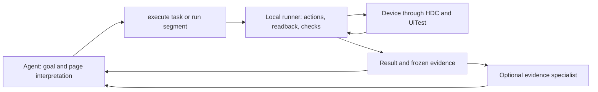

# Page analysis, bounded execution, and evidence

The outer agent interprets unfamiliar pages and chooses a task or segment. The runner handles target resolution, bounded control flow, live data bindings, readback, requested assertions and durable receipts without another model call. This guide covers `0.1.0a9`; recent-frame reuse and compact run/report defaults require alpha7, top-level `run.interactive` requires alpha8, and version 2 data bindings, `execute`, `start` and decision responses require alpha9.

## Complete a known task in one call

`execute` accepts an explicit device and a bounded plan with nonempty initial `preconditions` and final `goals`. The complete plan is statically validated before attachment or device access. The command attaches or resumes the same named session and device identity, then uses the existing runner to check the initial page and execute the workflow. It does not make a preliminary public observation and return control to the model. Initial checks share the ordinary first full frame; they do not introduce another capture or checks on every action.

Use the [complete synthetic workflow plan](../skills/harmony-agent/references/workflows.md#complete-two-page-example) through `execute --device DEVICE --session TASK --plan-file FILE`, or call MCP `harmony_execute` with the plan object. Reuse a validated plan file for new authorized tasks with the same contract; automatic run IDs avoid rewriting the file for each attempt. Page structure and flow must already be established by the task or verified evidence. Runtime values can remain unknown until the runner reads them. For exploration, use `start` to obtain the current page and `run` for a chosen segment.

Only `status: "completed"` with passed final goals triggers automatic release and detach. `keep_session: true` retains the session deliberately; failed, unknown or yielded workflows also retain it for recovery. `sessionCleanup` reports `detached`, `retained` or `failed` separately from the business result. Cleanup errors do not undo actions or replay the plan, and the device is never stopped. Detached session refs are invalid. The lifecycle receipt described below preserves the cleanup conclusion independently of the business run.

## Choose a segment that needs no new interpretation

For a complete known workflow with initial and final criteria, prefer `execute`. For an established session's authorized segment, submit one bounded `run` and return to the agent at completion or a meaningful decision boundary. Avoid splitting that sequence into one-action plans. Direct commands remain useful for isolated actions, diagnosis and unfamiliar pages.

Stop the segment where the next action needs a new page interpretation, a user choice or a necessary screenshot. Use `yield` when that boundary can be declared. Do not guess future controls, remove required evidence or assume authorization to increase the batch size. A plan cannot interpret an unfamiliar page on the agent's behalf.

When the page contract and workflow rules are known, version 2 can read live values and continue locally. `read` selects one exposed property from the full current frame; optional `stripPrefix` removes an exact literal prefix. `var` and string-only `concat` expressions may supply fill text and condition values, but cannot choose commands or selectors or run code. All branches are validated before execution; values missing on the actual path stop subsequent actions. Reads share the existing bounded frame cache and count against step budgets. The [workflow reference](../skills/harmony-agent/references/workflows.md) contains a complete example; version 1 remains supported.

The portable [Skill](../skills/harmony-agent/SKILL.md#choose-the-task-entry-point) owns this calling strategy. Distribute it with the matching runtime and references; host templates should use that strategy rather than maintaining another copy in installation or synchronization scripts.

## Read the page at the needed level

When exploration is needed, use `start --device ID --session NAME --json` to attach or resume and receive a current compact page and supported contract. It preserves an existing session's identity and device claim. A complete known workflow can use `execute` directly. Use `observe --compact --json` for a later fresh page. When grouping helps, `observe --view semantic --json` returns a `harmony-page/1` view with regions, app/window surfaces, fields, actions and business facts. Original text, empty values and exposed false booleans retain their meaning. Label provenance distinguishes native text from a contextual label. Anonymous nodes and duplicate labels retain context; a generated label is not an invented stable selector.

`execute` defaults to `output: "decision"`; `run` keeps its compatible full response default. Both accept either choice. Decision output aggregates successful steps and normal branch checks while retaining the final page, declared-goal results, exceptional receipts and a run evidence reference. The full result is persisted before projection. If persistence fails, the response retains all steps. This reduces returned detail, not native captures or internal checks. `report RUN_ID --full --json` expands saved evidence, including bound values and their source frames; its evidence check recomputes those values from frozen sources.

The default observation remains the existing tree view; `run` returns that view in compact form. Use a node budget that keeps the task's controls and business facts. From alpha8, `run` accepts top-level `interactive` for its tree output. Explicit projection options on the last executed command can override top-level choices; semantic output uses its own selection and does not apply the tree's interactive filter. Semantic projection is deterministic and local, but is not always smaller. Both views use the full native layout. Projection budgets can omit evidence; inspect `quality` and do not infer absence from a summary. Full-frame conditions evaluate the captured native tree, not all possible screen content. There is no semantic delta.

Use `inspect --frame-id <id> --run-id <run> --json` to expand a saved frame without HDC. Optional `--target` and `--max-nodes` bound the returned detail and retain relevant ancestry. `fresh=false` identifies frozen evidence. Prefer expanding the existing frame when only its returned detail was insufficient. This can resolve text provenance or duplicate-label questions without taking another screenshot or observation. A current-state decision still needs fresh evidence.

## Execute a short plan

The canonical format and synthetic examples are in the portable Skill's [plan reference](../skills/harmony-agent/references/plans.md). Retain the learned contract during a task; consult `schema run --json` or `schema execute --json` only when needed for an unfamiliar or incompatible field. The CLI accepts a reusable raw plan through `--plan-file`, inline `--plan` JSON, or a complete `--request` envelope; choose one. MCP `harmony_run` / `harmony_execute` accept the plan object directly.

Plans support commands, exact assertions, if/else, finite repetition, deliberate yield and stop. Mutation `expect` and `before` conditions are optional. Keep checks that establish the task's outcome or affect its next action, along with meaningful final goals. Related `before` checks share the action's target-resolution frame. Independent `assert` steps within a run also use recent-frame reuse; rewriting every assertion as `before` does not inherently reduce capture cost. `fill` still verifies input internally. Do not add a guard to every action or a second wait after a passed expectation. Unknown declared conditions stop the path; the runner does not infer undeclared page semantics.

All branches are validated before execution. Stable selectors are required; stale frame refs, arbitrary code, device switching and session changes cannot be embedded in a plan. The outer session selects the device. Control-flow conditions evaluate the latest verified frame once; use `wait` or an action's `expect` for polling.

Within one uninterrupted run, targets and `before` checks can reuse the last successfully published frame for up to 1000 ms after capture completes. Expired or invalid frames are captured again. This reuse never crosses CLI calls or model turns. Device readiness is checked once per run by default. A mutation step's `refresh: true` forces a new capture and device check when an asynchronous page change matters. The default saves repeated reads, but the app may change during the reuse interval; refresh cannot freeze it.

Successful intermediate steps stay inside the runner without generating another public page projection or rewriting the full session file. The journal and captured frames are retained. Use a persistent MCP connection when the host permits it to avoid repeated CLI startup. No model reviewer is needed for each step.

Budgets bound steps, high-level actions, captures and elapsed time. One `fill` is a high-level action that can involve several native input operations. HDC subprocess timeouts are clamped to the remaining plan budget. Deadline and cancellation checks are cooperative: already-dispatched operations can finish, and filesystem persistence is not forcibly interrupted. Budget exhaustion does not roll back prior effects.

## Interpret outcomes separately

| Field | What it establishes |
| --- | --- |
| Envelope `success` / CLI exit code | The request was handled or failed at the command layer |
| Run `status=completed` | The declared segment completed |
| `goalVerification.status=passed` | The declared final conditions passed |
| Action `dispatched=acknowledged` | Native execution acknowledged the action |
| Assertion `status=passed` | The exact comparison passed on its recorded frame |
| Report `evidenceCheck.complete=true` | Referenced frames are readable and recorded exact comparisons agree with them |
| Execute `sessionCleanup.status` | Whether this call detached, retained or failed to clean up its session |
| Report `workflowReceipt.available=true` | A separate lifecycle receipt records the cleanup conclusion for this attempt |

A successfully handled `run` or `execute` can return `failed`, `unknown`, `cancelled`, `budget_exhausted` or `yielded`. Check its status explicitly. A `run` without goals yields `not_requested`; `execute` rejects missing/empty goals before device access. Evidence completeness does not establish a meaningful business goal, cryptographic authenticity, or current device state. A last captured observation may precede a failed action; check `observationRole` and `frameValidForActions`.

## Keep one device writer and query interrupted runs

The runner claims the device for its named session. For `run` and retained `execute` sessions, ownership persists across segments and processes until `release` or `detach`; verified `execute` completion normally performs that cleanup itself. A global device lock serializes active commands, including across state directories. Another session cannot mutate an owned device. Read-only capture can still run between segments; ownership does not block a person or unrelated automation tool.

Keep the run ID before dispatch. Its directory is reserved once, and a reused ID fails with `RUN_EXISTS`. After a lost reply, read `harmony-agent report RUN_ID --json`; the run ID is positional. JSON requests and MCP use the field `run_id`, while CLI `inspect` has a `--run-id` option. See [matching request examples](../skills/harmony-agent/references/requests.md#read-a-saved-run). Never infer that missing output means an action did not happen. A crashed owner is not automatically replaced. Resume that session, inspect the record, observe current state, and decide whether a new plan is justified or ownership should be released.

Run records live under the selected state directory's `runs/` folder. They contain the validated plan, per-step intent/result, frame IDs, assertions and frozen frames. `report` and run-scoped `inspect` work after detach and without HDC. Report verification re-evaluates stored exact comparisons from frozen frames. Persistence failures stop execution and preserve uncertainty. Request IDs and receipts cannot provide device-level exactly-once guarantees across every crash boundary.

`execute` writes one small atomic `workflow.json` lifecycle receipt after its cleanup decision. It contains the run/session identity, cleanup conclusion and timestamp; the already persisted business run is not rewritten. `workflowReceiptAvailable: false` and a warning report a sidecar write failure without changing completed actions or their goal result.

After a lost response, `report.workflowReceipt` exposes this independent record. Its `available: false` with unknown cleanup means the lifecycle record is missing, unreadable, invalid or inconsistent with the run identity. The business report remains separately usable. Neither a completed business run nor historical `frameValidForActions` proves successful cleanup. A valid receipt records what happened at that attempt's completion, not current session state after later commands. Resolve outstanding session questions without replaying the workflow.

`report` checks the complete saved evidence before returning a compact view. Receipts, goals and unique errors remain. Duplicate `result.steps` entries are removed, and `result.observation` becomes `result.observationRef` for expansion through `inspect`. Use `report RUN_ID --full --json` or MCP `full: true` when the complete saved representation is needed. The compact view does not discard stored frames or skip evidence verification. A successful run already returns its status, goals and final view; do not fetch the same report after each segment unless recovery or an evidence question requires it.

## Measure the intended improvement

`--profile` reports core wall time and named stages; `run` and `execute` include a profile automatically. Execute's core wall includes its lifecycle work. Stages can nest, so do not sum them as mutually exclusive buckets. CLI startup, output serialization, host scheduling and model inference are outside core wall time. Model time and token counts remain `null` when unmeasured.

Compare equivalent tasks, including successful outcomes, wrong actions, missed conditions, captures, host calls, wall time, response bytes and actual model usage when available. Complete task timing includes planning and request construction before the first tool, plus verification and cleanup. Label a first-to-last tool window separately. Include asynchronous changes when evaluating frame reuse. Fewer CLI calls or bytes alone does not prove lower end-to-end latency or model cost.

Use the [performance measurement guide](performance.md) to separate command time from unclassified time between calls, and to compare calling strategies on the same core before changing the core. Keep required actions, screenshots and success conditions matched. A frame reused for a condition is not necessarily a frame reused for the next action's target.

## Portability and local data

The same core serves CLI and local stdio MCP. The repository includes the complete Skill, an installer and host templates. See [agent integrations](integrations.md), [optional multi-agent roles](multi-agent.md), and [validation boundaries](compatibility.md).

Keep request files, raw frames, screenshots and detailed run records under the ignored local state directory. They can contain sensitive application data. Public examples and regression fixtures use synthetic data. Local persistence does not imply that tool results sent to a host model stay local. The package does not start models, charge model credits, or run a network service.
