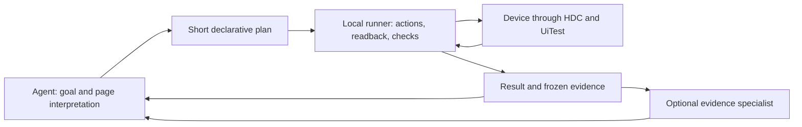

# Page analysis, bounded execution, and evidence

Version `0.1.0a7` corrects the extra work in alpha6's local execution layer. The outer Agent interprets unfamiliar pages and decides what to do. The runner handles target resolution, bounded control flow, readback, requested assertions and durable receipts without another model call. The defaults described here require alpha7.

## Read the page at the needed level

Start with `observe --compact --json`. When grouping helps interpret a page, `observe --view semantic --json` returns a `harmony-page/1` view with regions, app/window surfaces, fields, actions and business facts. Original text, empty values and exposed false booleans retain their meaning. Label provenance distinguishes native text from a contextual label. Anonymous nodes and duplicate labels are retained with context; a generated label is not an invented stable selector.

The default observation remains the existing tree view; `run` returns that view in compact form. Semantic projection is deterministic and local, but is not always smaller. Both views use the full native layout. Projection budgets can omit evidence; inspect `quality` and do not infer absence from a summary. There is no semantic delta.

Use `inspect --frame-id <id> --run-id <run> --json` to expand a saved frame without HDC. Optional `--target` and `--max-nodes` bound the returned detail and retain relevant ancestry. `fresh=false` identifies frozen evidence. This can resolve text provenance or duplicate-label questions without taking another screenshot or observation. A current-state decision still needs fresh evidence.

## Execute a short plan

The canonical format and complete synthetic example are in the portable Skill's [plan reference](../skills/harmony-agent/references/plans.md). Obtain the installed contract with `schema run --json`. Send UTF-8 JSON using `--request`, or use the optional MCP `harmony_run` tool.

Plans support commands, exact assertions, if/else, finite repetition, deliberate yield and stop. Mutation `expect` and `before` conditions are optional. Keep checks that establish the task's outcome or affect its next action, along with meaningful final goals. `fill` still verifies input internally. Do not add a guard to every action or a second wait after a passed expectation. Unknown declared conditions stop the path; the runner does not infer undeclared page semantics.

All branches are validated before execution. Stable selectors are required; stale frame refs, arbitrary code, device switching and session changes cannot be embedded in a plan. The outer session selects the device. Control-flow conditions evaluate the latest verified frame once; use `wait` or an action's `expect` for polling.

Within one uninterrupted run, targets and `before` checks can reuse the last successfully published frame for up to 1000 ms after capture completes. Expired or invalid frames are captured again. This reuse never crosses CLI calls or model turns. Device readiness is checked once per run by default. A mutation step's `refresh: true` forces a new capture and device check when an asynchronous page change matters. The default saves repeated reads, but the app may change during the reuse interval; refresh cannot freeze it.

Successful intermediate steps stay inside the runner without generating another public page projection or rewriting the full session file. The journal and captured frames are retained. Use a persistent MCP connection when the host permits it to avoid repeated CLI startup. No model reviewer is needed for each step.

Budgets bound steps, high-level actions, captures and elapsed time. One `fill` is a high-level action that can involve several native input operations. HDC subprocess timeouts are clamped to the remaining plan budget. Deadline and cancellation checks are cooperative: already-dispatched operations can finish, and filesystem persistence is not forcibly interrupted. Budget exhaustion does not roll back prior effects.

## Interpret outcomes separately

| Field | What it establishes |
| --- | --- |
| Envelope `success` / CLI exit code | The request was handled or failed at the command layer |
| Run `status=completed` | The declared segment completed |
| `goalVerification.status=passed` | The declared final conditions passed |
| Action `dispatched=acknowledged` | Native execution acknowledged the action |
| Assertion `status=passed` | The exact comparison passed on its recorded frame |
| Report `evidenceCheck.complete=true` | Referenced frames are readable and recorded exact comparisons agree with them |

A successfully handled `run` can return `failed`, `unknown`, `cancelled`, `budget_exhausted` or `yielded`. Check its status explicitly. No goals yields `not_requested`, not implicit task success. Evidence completeness does not establish a meaningful business goal, cryptographic authenticity, or current device state. A last captured observation may precede a failed action; check `observationRole` and `frameValidForActions`.

## Keep one device writer and query interrupted runs

`run` claims the device for its named session. Task ownership persists across plan segments and processes until explicit `release` or `detach`. A global device lock serializes active commands, including across state directories. Another session cannot mutate an owned device. Read-only capture can still run between segments; ownership does not block a person or unrelated automation tool.

Keep the run ID before dispatch. Its directory is reserved once, and a reused ID fails with `RUN_EXISTS`. After a lost reply, read `report --run-id <id> --json`; never infer that missing output means an action did not happen. A crashed owner is not automatically replaced. Resume that session, inspect the record, observe current state, and decide whether a new plan is justified or ownership should be released.

Run records live under the selected state directory's `runs/` folder. They contain the validated plan, per-step intent/result, frame IDs, assertions and frozen frames. `report` and run-scoped `inspect` work after detach and without HDC. Report verification re-evaluates stored exact comparisons from frozen frames. Persistence failures stop execution and preserve uncertainty. Request IDs and receipts cannot provide device-level exactly-once guarantees across every crash boundary.

`report` checks the complete saved evidence before returning a compact view. Receipts, goals and unique errors remain. Duplicate `result.steps` entries are removed, and `result.observation` becomes `result.observationRef` for expansion through `inspect`. Use `report --full` or MCP `full: true` when the complete saved representation is needed. The compact view does not discard stored frames or skip evidence verification.

## Measure the intended improvement

`--profile` reports core wall time and named stages; `run` includes a profile automatically. Stages can nest, so do not sum them as mutually exclusive buckets. CLI startup, output serialization, host scheduling and model inference are outside core wall time. Model time and token counts remain `null` when unmeasured.

Compare the compact-output workflow with semantic output and bounded plans on equivalent tasks. Record successful outcomes, wrong actions, missed conditions, captures, host calls, wall time, response bytes and actual model usage when available. Include asynchronous page changes when evaluating frame reuse. Fewer CLI calls or bytes alone does not prove lower end-to-end latency or model cost.

## Portability and local data

The same core serves CLI and local stdio MCP. The repository includes the complete Skill, an installer and host templates. See [agent integrations](integrations.md), [optional multi-agent roles](multi-agent.md), and [validation boundaries](compatibility.md).

Keep request files, raw frames, screenshots and detailed run records under the ignored local state directory. They can contain sensitive application data. Public examples and regression fixtures use synthetic data. Local persistence does not imply that tool results sent to a host model stay local. The package does not start models, charge model credits, or run a network service.
